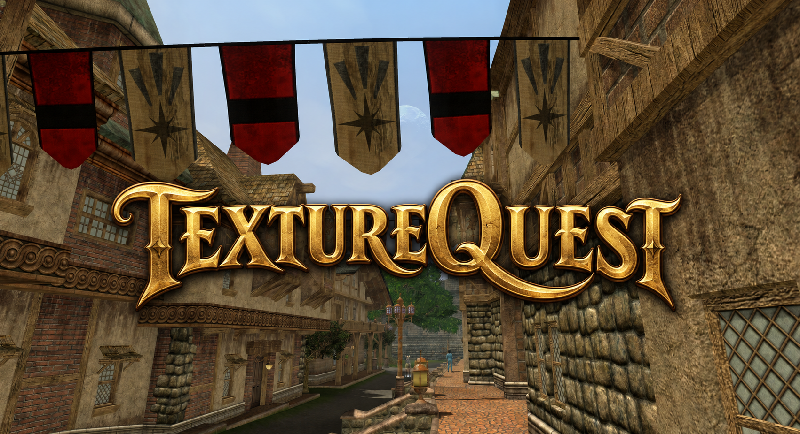
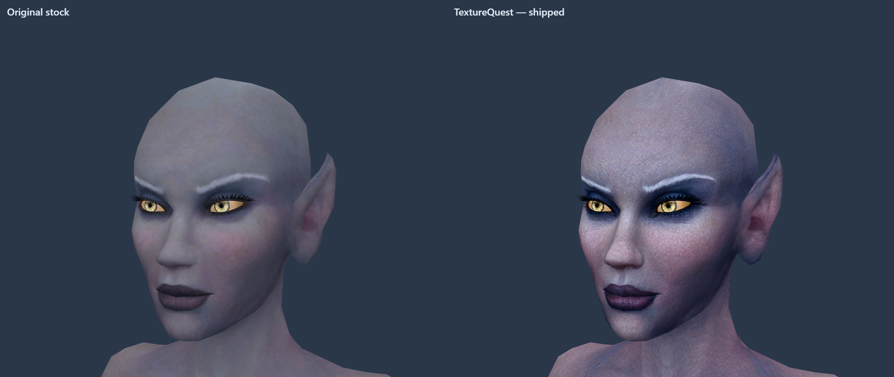

# TextureQuest

**More detail. The EverQuest II you remember.**

TextureQuest is a community texture pack for **EverQuest II Origins**. Its aim is to retain the game's original style, recognizable designs and art direction while bringing out the detail in armor, creatures, signs, buildings and terrain.

AI-assisted upscaling adds finer surface detail while keeping the familiar look of Norrath. The pack includes more than **23,000 textures**, mostly at **1K or 2K**, with selected large creatures and heavily stretched surfaces at **4K**. It covers equipment, characters, creatures and environments. The game's models, animations and lighting remain unchanged. Some fine detail is newly generated, and results vary by texture.

## Download and install

**[Download the Windows installer from the latest release](https://github.com/Maergoth/TextureQuest/releases/latest)**

1. **Patch the game first**, then close every EQ2 client and the launcher.
2. Extract the installer ZIP into a writable folder outside the game. Keep its contents together and open **TextureQuest.exe**.
3. Choose the game folder containing `EverQuest2.exe` and `paks`. The installer checks the latest texture release and downloads the files it needs. Interrupted downloads can be resumed. No separate texture ZIP, Python, AI software or GPU generation is needed.
4. Once the pack is ready, click **Install TextureQuest**. Wait for verification to finish.

The current textures take about **28.4 GB** in one cache of ready-to-use archives under `data/downloads`. There is no second extracted pack or texture ZIP. Allow additional room for the installed game and one temporary archive during installation; the largest current archive is about 512 MB. The app checks space as it works, resumes interrupted downloads, and reuses unchanged files. Keep the app's `data` folder so you can reinstall after patches. Installation starts only when you click Install.

**After a game patch:** close the game and launcher, then rerun the TextureQuest installer. It checks for the latest textures and reuses verified downloads. Do not skip required game updates.

The app checks **texture updates and app updates separately** on startup. Use **Maintenance & updates → Check for updates** to check again. New textures are downloaded and prepared in this app; **Get app update** opens the official GitHub release page for a newer installer. Downloading never installs anything automatically. If a check fails, the app says it could not verify that update and keeps saved files.

When upgrading the app, close the old copy, extract the new installer into a new folder, and move your existing `data` folder alongside the new `TextureQuest.exe` to keep downloads and installation records. An app update can use the same textures you already have.

App 1.3 moves verified archives from the old `prepared` cache into `downloads` and removes recognized redundant texture ZIPs after the complete cache verifies. This reuses your saved textures without downloading the whole pack again. Unrecognized or changed files are kept.

**To return to stock:** run the official patcher's file validation to restore the original game files.

**Compatibility:** this pack was developed for EverQuest II Origins. Other EQ2 versions and later content updates have not been fully tested. Some textures are intentionally left unchanged for compatibility.

## Examples

Close-ups of older Norrath, using the original game models and their material layers with matching cameras and lighting. Original textures are on the left; released TextureQuest textures are on the right. These are 3D previews; appearance in game will vary with lighting, settings and character customization.

Expand a category to see close-up comparisons.

<strong>Armor</strong>

**Faydark plate — engraved metal and scrollwork**

<strong>Weapons and shields</strong>

**Qeynos Guard — metalwork, gem and glowing runes**

**Dragon Sharp — blade and decorated grip**

<strong>Monsters</strong>

**The Leviathan — mouth, teeth and scales**

Original 1K artwork beside the released 4K texture on the complete model.

**Hell Boar — fur, skin and tusks**

**Flesh Golem — face, skin and stitching**

<strong>Player faces</strong>

**Dark Elf — skin and facial detail**

<strong>Architecture and signage</strong>

**Signage — the bakery sign**

**Wood and metal — a Freeport door**

<strong>Terrain</strong>

**Terrain — Darklight Woods grass**

[View the full-size gallery](docs/GALLERY.md), including details about how the comparisons were made.

## Limitations

- **Seams and tiling can become more visible.** The original low-resolution textures softened or concealed some joins, repeated patterns and mismatched material boundaries. More detail can expose them.
- **AI can get details wrong.** Small lettering, symbols, eyes and tightly packed texture regions are particularly difficult. Some source information simply does not exist at higher resolution.
- **The original geometry still matters.** Low-polygon silhouettes, UV stretching, separate body parts and LOD changes remain. Texture work cannot fix every model or shader issue.
- **Some appearances may still have issues.** Character variants, facial customization and layered materials can produce results that differ from the previews.
- **Higher-resolution textures use more resources.** Storage, loading behavior and texture memory requirements can increase. Performance depends on your settings and system; no minimum hardware or FPS improvement is claimed.
- **Game patches can overwrite the pack.** Rerun the installer after patching.

Please [report a problem](https://github.com/Maergoth/TextureQuest/issues/new/choose) with the game version/server, zone or item/NPC, character race/gender/appearance where relevant, a close-up screenshot, and the TextureQuest version installed. Include whether **Verify installed textures** passes. Do not include account credentials or private logs.

## Updates

The installer checks the [latest release](https://github.com/Maergoth/TextureQuest/releases/latest) and fetches its required texture files. Installation still requires clicking **Install TextureQuest**.

After a game patch, rerun the installer. Saved files that still match the current release are reused.

### Can this leave the game's PAKs untouched?

The supported installer replaces PAK files. **Sideload** is an experimental option under development and is currently unavailable. A texture-injection tool would need to intercept rendering and reliably identify the game's textures; ordinary ReShade color presets cannot load this pack. No injection method has been validated for this release.

We have no confirmation from Daybreak approving either approach. The 1.1 installer displays this warning:

> We don't know what's more legal, replacing the game files or hooking the process. If Daybreak hates you, they might ban you. Be warned.

### Can I choose only races, armor, weapons or an expansion?

The installer installs the complete pack. Separate content selections are not available because the game's archives mix equipment, characters and shared world textures.

## Technical details and contributing

The [technical guide](docs/TECHNICAL.md) covers the model and generation recipe, resolution selection, material and DDS compatibility findings, corrections, validation, and building the installer. It also explains what is available to reproduce from this repository.

For manual downloads and checksums, use the [release files](https://github.com/Maergoth/TextureQuest/releases/latest). The installer fetches and verifies the required base and update files automatically. GitHub's **Source code (zip)** does not contain the textures.

## Credits and ownership

TextureQuest is an unofficial community project and is not affiliated with or endorsed by the EverQuest II developers or publisher. The original game artwork, names and trademarks belong to their respective owners. Distribution of this pack does not grant ownership of or relicense the underlying game assets. Third-party software notices are included with the installer.
