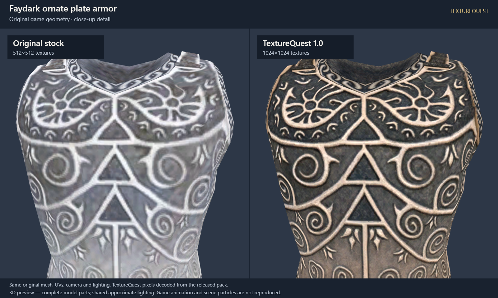
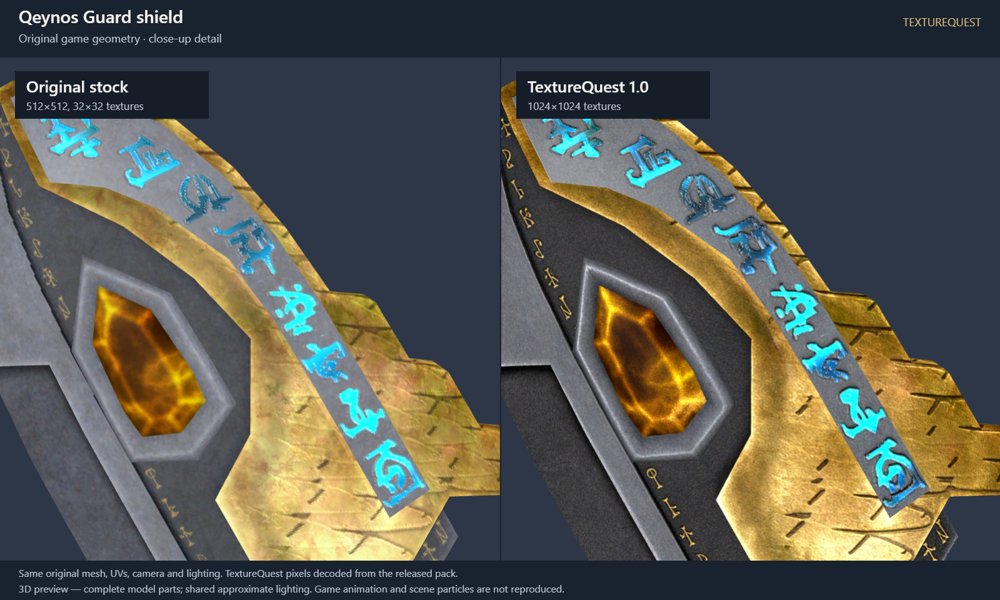
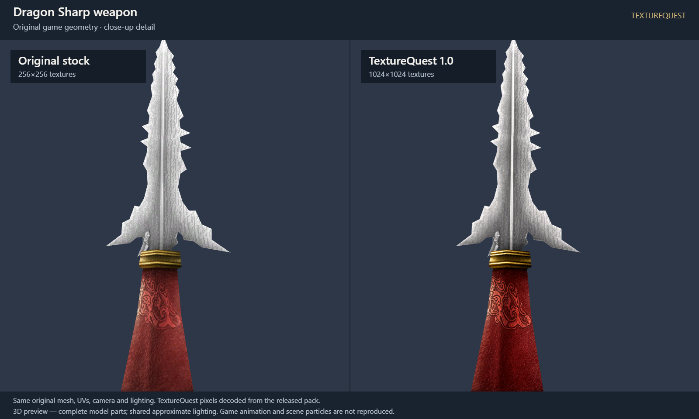
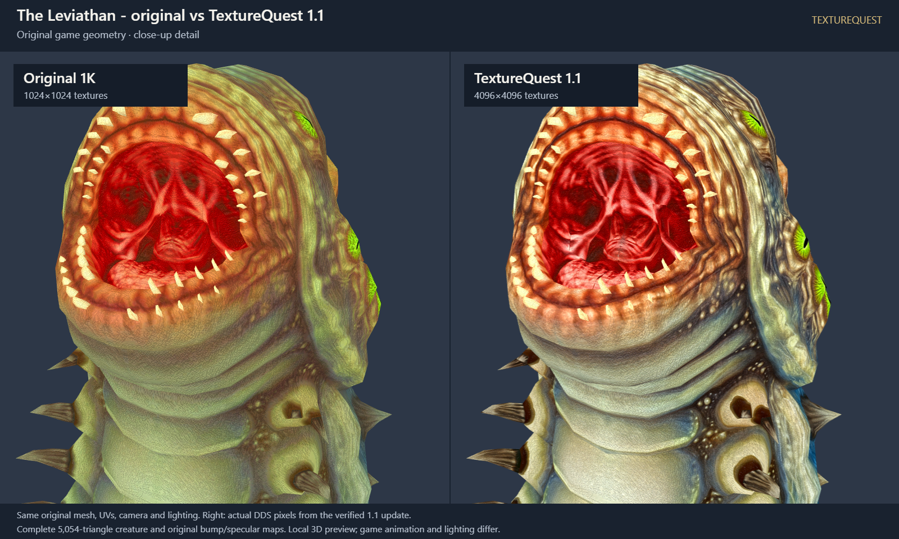
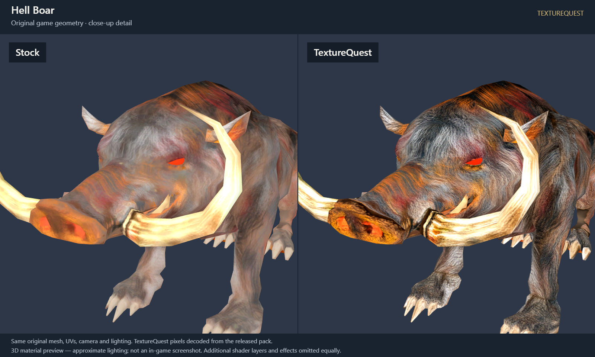
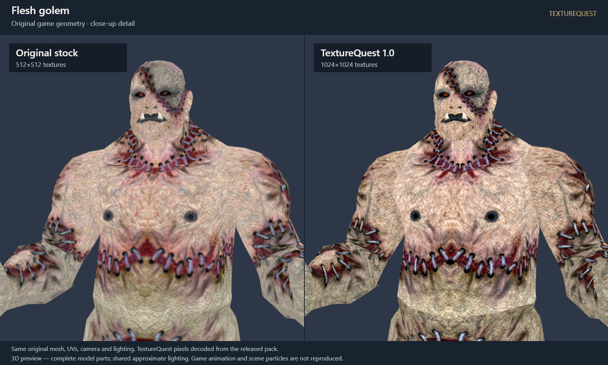
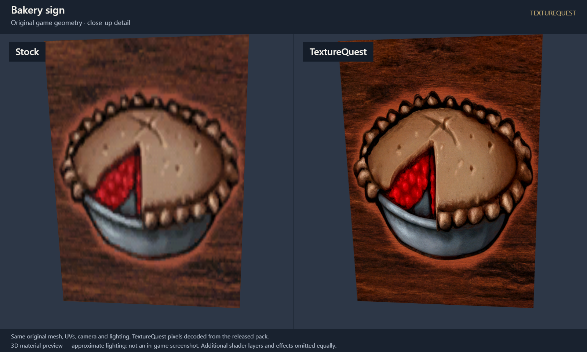
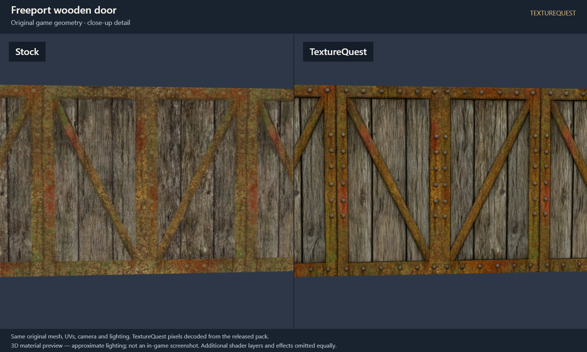
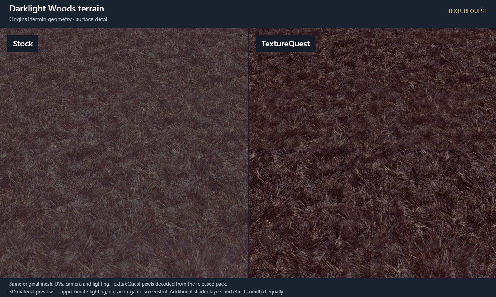

# Stock and TextureQuest, up close

Original game geometry, with matching cameras and lighting. **Original stock** uses native texture sizes, often 512 × 512; the Leviathan body is originally 1024 × 1024. **TextureQuest** uses the exact released textures: the Leviathan's 4K texture from **1.1**, and the unchanged base textures for the other examples. Each image labels the resolutions. Click for the full 1600 × 960 comparison.

These are **3D previews, not in-game screenshots**. Complete objects and their material layers are assembled; terrain is a cropped mesh patch. Lighting and static poses are approximations. Sharper textures can expose existing seams and repeating patterns.

## Armor

Faydark plate armor on its complete original chest mesh, with embossed metal, scrollwork and fitted trim. Both source tint masks use neutral customization.

## Weapons and shields

Qeynos Guard, viewed from the front: shield body, gem and rune material are all included. Both tint masks use neutral customization; the two scrolling rune layers share the same frozen instant.

Dragon Sharp blade on its complete original weapon mesh, with its color, bump and specular inputs.

## Monsters

The Leviathan, with the complete original 5,054-triangle body mesh and unchanged bump and specular maps on both sides. The close-up shows the mouth, teeth and scales. Left: native 1024 × 1024 color texture. Right: the actual 4096 × 4096 DDS texture from the released 1.1 pack, with its color finish and compression.

[Leviathan comparison provenance](leviathan-4k-provenance.json) records the released DDS, source, complete geometry, shared camera and exact browser export.

Hell Boar, with both original head and body materials. The camera focuses on the face and upper body; all original geometry remains in the scene.

Flesh Golem, including both the head/chest and arms/legs material groups. The close framing emphasizes skin and facial detail.

## Architecture and signage

Bakery artwork on the complete original easel assembly, including the sign, canvas backing and iron stand.

Freeport wooden door, with original wood grain, iron braces and rivets, plus the protected bump and specular maps.

## Terrain

Darklight Woods grass on a contiguous patch of its actual terrain mesh. The base texture and terrain overlay use their original separate UV sets. This is a close-up patch, not a recreation of the whole zone.

## How these comparisons were made

The right-hand textures were decoded from the released DDS files, including the pack's color finish and compression. The previews apply no extra color correction. Original geometry, UV coordinates, cameras and lighting are shared. Proven color layers, tint masks and protected surface maps are included; scrolling layers use a shared frozen instant. Exact game lighting, animation, particles and supplied mip chains are not reproduced.

[Image and source provenance](gallery-provenance.json) records the exact release checksum, sampled source identities, materials, cameras and exported image hashes. Only the needed retained samples were decoded; no second full collection of stock textures was created.
