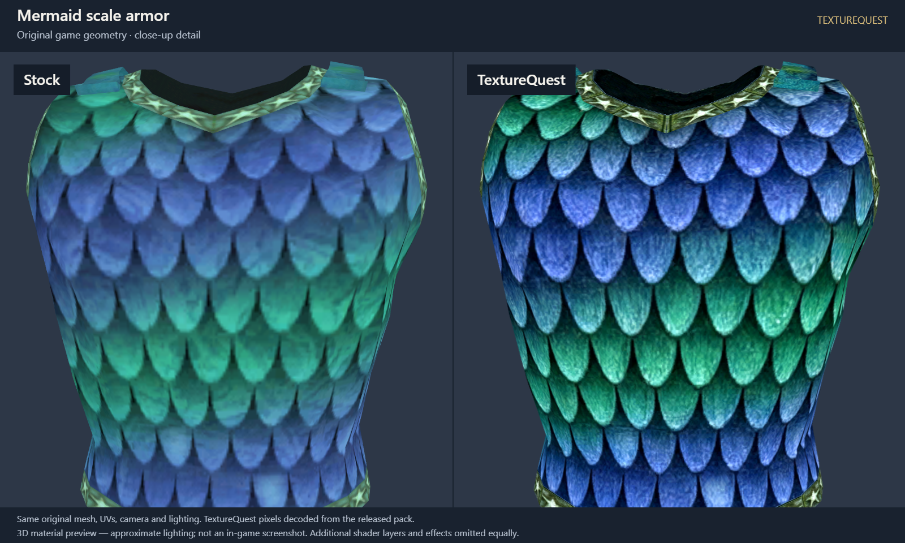

# Stock and TextureQuest, up close

These comparisons use original game meshes and UV coordinates, with the same camera and neutral lighting on both sides. The right side is decoded directly from the released Texture-Pack.zip, including its color finish and DDS compression. Click an image to inspect its full 1600 × 960 resolution.

These are **3D material previews, not in-game screenshots**. They isolate texture detail: additional shader layers, effects, animation and world lighting are omitted equally. In-game appearance can differ. Original geometry, seams and repeated UV layouts remain; sharper textures do not repair the underlying models.

## Armor

Mermaid scale armor on the original human male chest mesh, showing scales and trim. The selected color material is isolated from additional shader layers.

## Monsters

Hell Boar, with the original head and body materials: fur, skin, tusks and claws.

## Signage

Bakery sign artwork on its verified in-game painting/easel surface. The camera focuses on the illustrated material, excluding the stand.

## Wood and metal

Freeport wooden door: wood grain, iron braces, weathering and rivets on the original door geometry.

## Terrain

A close-up of an actual Darklight Woods terrain mesh patch with its original UVs. This shows the grass base layer; it does not reconstruct the zone's additional blend layers or lighting.

[Image and source provenance](gallery-provenance.json) records the exact released ZIP checksum, DDS sources, game meshes, camera positions and image checksums. Only these small samples were decoded for the gallery; creating a second collection of all original textures was unnecessary.
